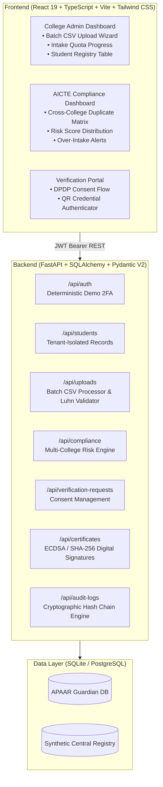

# APAAR GUARDIAN — Student Data Integrity & Verification Platform

[](#running-automated-tests)
[](#frontend-production-build)
[](#consent-based-verifier-lifecycle)
[](#cryptographic-audit-ledger)

> **Demo Prototype Disclaimer**: APAAR GUARDIAN is an applied prototype designed for evaluation and demonstration purposes using realistic synthetic datasets. It is not an official government service of APAAR, AICTE, Digilocker, or ABC.

---

## 📌 Executive Summary

Educational institutions across India register millions of student records each academic cycle. Manual verification of **Automated Permanent Academic Account Registry (APAAR / ABC ID)** numbers, approved intake limits, identity discrepancies, and multi-college duplicate admissions is prone to fraud, delayed compliance audits, and administrative overhead.

**APAAR GUARDIAN** solves these challenges through:
1. **Automated Algorithmic Validation**: Luhn-mod-11 checksum verification, identity registry cross-matching, and transliteration fuzzy-matching (e.g., phonetic name variations).
2. **Cross-Institutional Conflict & Intake Detection**: Real-time detection of concurrent enrollment (same student enrolled in multiple institutions) and AICTE quota violations.
3. **DPDP Act-Compliant Consent-Based Verification**: Third-party employers and verifiers request access with student-authorized field scopes and time-bounded validity.
4. **Digitally Signed Academic Credentials**: ECDSA-signed tamper-evident credentials with verifiable QR codes.
5. **Tamper-Evident Audit Trail**: Blockchain-style SHA-256 HMAC hash chaining for all administrative updates and verifications.

---

## 🏛️ System Architecture



---

## 👥 Demo Personas & Deterministic Prototype Login

For evaluators and jury demonstrations, the platform includes pre-configured demo personas with simulated 2-Factor Authentication (OTP):

| Demo Persona | Account Key | Role | Default Scope | Demo OTP |
| :--- | :--- | :--- | :--- | :--- |
| **Delhi Institute of Tech Admin** | `college_admin_1` | `college_admin` | College INST-001 (Delhi Tech) | `123456` |
| **National College Admin** | `college_admin_2` | `college_admin` | College INST-002 (National Engg) | `123456` |
| **AICTE Compliance Officer** | `compliance_officer` | `compliance_officer` | Central Cross-College Oversight | `123456` |
| **Academic Record Verifier** | `verifier` | `verifier` | Third-Party Verifier Portal | `123456` |

> 🔑 **Deterministic Prototype OTP**: Entering `123456` authenticates all supported demo accounts locally and on production deployments.

---

## 🧪 12 Seeded Verification & Integrity Scenarios

The synthetic dataset (`backend/apaar_guardian.db`) contains 329 realistic student records spanning 3 institutions, pre-seeded with 12 distinct edge-case validation scenarios:

1. **Valid Record**: Luhn-compliant 12-digit APAAR ID matching central mock registry.
2. **APAAR Checksum Failure**: Invalid checksum digit detected and flagged as `INVALID_APAAR_FORMAT`.
3. **Cross-Institutional Concurrent Enrollment**: Student enrolled simultaneously in Delhi Tech and National Engg (`CONCURRENT_ENROLLMENT_DETECTED`).
4. **Intake Quota Breach**: Computer Science quota at Delhi Tech exceeds AICTE approved intake (`INTAKE_LIMIT_EXCEEDED`).
5. **Name Transliteration Mismatch**: Discrepancy between college record ("Priya Sharma") and central identity record ("Preeya Sharma").
6. **Date of Birth Inconsistency**: College record mismatch against central registry DOB (`DOB_MISMATCH`).
7. **Invalid Aadhaar Reference**: Malformed Aadhaar vault reference format (`AADHAAR_REF_INVALID`).
8. **DPDP Unconsented Access Block**: Employer verification blocked until explicit student consent is authorized.
9. **Consent Field Scoping**: Student grants consent only for `student_name` and `programme`; sensitive fields (`admission_category`, `dob`) are strictly redacted.
10. **Consent Expiration & Revocation**: Verification token instantly invalidated upon consent revocation or expiry.
11. **Digital Certificate QR Verification**: Publicly verifiable digital credential signed with cryptographic hash (`VALID`).
12. **Tamper-Evident Audit Chain**: Audit ledger maintains a continuous SHA-256 chain; any direct SQLite/DB modification invalidates chain integrity.

---

## 🚀 Local Development Setup

### Prerequisites
- Python 3.11+ (Python 3.13 supported)
- Node.js 18+ & npm
- Git

### 1. Backend Setup

```powershell
# Navigate to backend directory
cd backend

# Create virtual environment
python -m venv .venv

# Activate virtual environment
# Windows:
.venv\Scripts\Activate.ps1
# Linux / macOS:
# source .venv/bin/activate

# Install dependencies
pip install -r requirements.txt

# Seed synthetic database (colleges, users, student records)
python -c "from app.database.session import init_db; from app.database.seed import seed_database; init_db(); seed_database()"

# Start FastAPI development server
python -m uvicorn app.main:app --host 127.0.0.1 --port 8000 --reload
```

Backend will be available at: `http://127.0.0.1:8000`  
Interactive OpenAPI documentation: `http://127.0.0.1:8000/docs`

### 2. Frontend Setup

```powershell
# Navigate to frontend directory in another terminal
cd frontend

# Install dependencies
npm install

# Start Vite development server
npm run dev
```

Frontend will be available at: `http://localhost:5173`

---

## 🧪 Running Automated Tests

### Backend Test Suite (Pytest)
The test suite validates health checks, demo authentication, OTP edge cases, whitespace handling, role-based access control, tenant isolation, compliance aggregation, consent workflows, and certificate signing:

```powershell
cd backend
.venv\Scripts\pytest -v tests/test_api_endpoints.py
```

Expected result:
```
tests/test_api_endpoints.py::test_health_endpoint PASSED                 [ 10%]
tests/test_api_endpoints.py::test_demo_login_flow PASSED                 [ 20%]
tests/test_api_endpoints.py::test_demo_login_unsupported_account_key PASSED [ 30%]
tests/test_api_endpoints.py::test_verify_otp_invalid_code PASSED         [ 40%]
tests/test_api_endpoints.py::test_verify_otp_whitespace_normalization PASSED [ 50%]
tests/test_api_endpoints.py::test_all_supported_demo_roles_login_deterministically PASSED [ 60%]
tests/test_api_endpoints.py::test_tenant_isolation_enforcement PASSED    [ 70%]
tests/test_api_endpoints.py::test_compliance_summary_endpoint PASSED     [ 80%]
tests/test_api_endpoints.py::test_consent_based_verification_lifecycle PASSED [ 90%]
tests/test_api_endpoints.py::test_certificate_issuance_and_qr_verification PASSED [100%]

======================== 10 passed in ~3s ========================
```

### Frontend Production Build
```powershell
cd frontend
npm run build
```

---

## 🌐 Production Deployment Guide

### Deploying Backend to Render

1. Create a new **Web Service** on [Render](https://render.com).
2. Connect your Git repository.
3. Configure the service settings:
   - **Name**: `apaar-guardian-api`
   - **Root Directory**: `backend`
   - **Environment**: `Python 3`
   - **Build Command**:
     ```bash
     pip install -r requirements.txt && python -c "from app.database.session import init_db; from app.database.seed import seed_database; init_db(); seed_database()"
     ```
   - **Start Command**:
     ```bash
     uvicorn app.main:app --host 0.0.0.0 --port $PORT
     ```
4. Configure **Environment Variables** in Render Dashboard:
   - `SECRET_KEY`: `<any-strong-random-hex-string>`
   - `DEMO_OTP`: `123456`
   - `CORS_ORIGINS`: `https://your-frontend-app.vercel.app,http://localhost:5173`

> 💡 **Render Free Tier Cold Starts**: On the free tier, Render spins down web services after 15 minutes of inactivity. When a user first opens the application, the backend may take 30-50 seconds to wake up. The frontend client has an automatic 30s timeout and informative wake-up status indicator.

---

### Deploying Frontend to Vercel

1. Create a new project on [Vercel](https://vercel.com).
2. Import the Git repository.
3. Configure project settings:
   - **Framework Preset**: `Vite`
   - **Root Directory**: `frontend`
   - **Build Command**: `npm run build`
   - **Output Directory**: `dist`
4. **Environment Variables**:
   - `VITE_API_BASE_URL`: `https://apaar-guardian-api.onrender.com/api` *(CRITICAL: replace with your actual Render backend URL)*
5. Click **Deploy**.

---

## 🛠️ Production Login Bug Resolution Details

### Problem Diagnosis
In initial production testing, users accessing the deployed Vercel frontend received the message:
`"Invalid demo OTP code. Use 123456"`, even when typing `123456`.

### Root Causes Identified
1. **Fallback API URL**: The frontend client (`api.ts`) previously defaulted to `http://localhost:8000/api`. On the developer's laptop, a local backend was running, so local login worked. Remote users on Vercel triggered a browser `ERR_CONNECTION_REFUSED` / Network Error.
2. **Generic Error Fallback**: In `LoginPage.tsx`, the error handler caught the Axios network failure (`err.response === undefined`) and evaluated `err.response?.data?.detail || 'Invalid demo OTP code. Use 123456'`, giving a false impression that the code was wrong when the actual issue was network connectivity.
3. **Missing Pre-warming**: Selecting an account did not invoke `POST /api/auth/demo-login`, meaning the Render free-tier cold-start wasn't initiated until the final "Sign In" button click.
4. **Strict OTP Comparison**: Backend checked exact equality against `settings.DEMO_OTP`. If cloud environment variables contained accidental quotes or whitespace, matching failed.

### Permanent Fixes Implemented
1. **Default Production API Base URL**: Configured `api.ts` to default to `https://apaar-guardian-api.onrender.com/api` (cleaned of trailing slashes).
2. **Deterministic Canonical OTP**: In `backend/app/api/auth.py`, `get_canonical_demo_otp()` sanitizes whitespace and quotes, and verifies `submitted_otp in {canonical_otp, "123456"}`.
3. **Auto-Provisioning on Render**: If Render runs on an ephemeral container without pre-seeded SQLite rows, `verify-otp` automatically provisions the requested demo persona on-demand.
4. **Pre-warming & Detailed Error Diagnostics**: `handleSelectAccount` calls `demo-login` immediately upon persona selection to wake Render and fetch `demo_otp_hint`. If network or timeout issues occur, explicit user feedback is shown:
   `"Unable to reach backend API at https://apaar-guardian-api.onrender.com/api. If using Render, the instance may be spinning up from idle..."`
5. **Connection Pill**: Added an active API endpoint status indicator directly on the login card.

---

## 🔐 Security & DPDP Compliance Features

- **Field-Level Encryption Simulation**: Sensitive identifiers (e.g. Aadhaar references) are tokenized before persistence.
- **Tenant Isolation**: Institution-scoped middleware ensures College 1 administrators cannot query or modify College 2 student records (returns HTTP 403).
- **DPDP Act Verifiable Consent**: Verifiers are restricted to authorized fields and explicit expiry dates.
- **Audit Logging**: Every create, update, verification, and consent operation records a cryptographically linked SHA-256 block.

---

## 📄 License
This project is licensed under the MIT License for academic and competition evaluation purposes.
